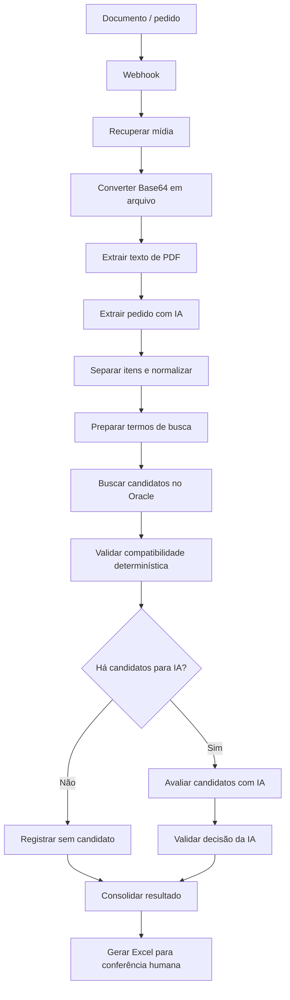

# AI Purchase Order Product Matcher

> **Status: Protótipo em desenvolvimento.**
>
> Este projeto ainda está sendo desenvolvido e validado. A arquitetura, as regras de correspondência, os prompts, os critérios de decisão e a estrutura do workflow podem mudar.

Protótipo de correspondência inteligente entre itens de pedidos de compra e produtos cadastrados, desenvolvido com n8n, OpenAI e Oracle.

## Objetivo

A ideia de longo prazo é receber informações de uma solicitação comercial — imagem, PDF, foto ou texto — interpretar os itens e ajudar a montar um orçamento no Winthor, reduzindo o trabalho manual de ler o pedido e digitar seus itens.

O workflow disponível cobre apenas parte dessa visão: recebe uma mídia por integração HTTP, processa PDF, extrai os itens com IA, procura produtos candidatos no Oracle, valida compatibilidade e gera um Excel para conferência humana. Não há neste protótipo um fluxo documentado de criação/gravação do orçamento no Winthor, nem suporte comprovado a todos os formatos citados. O resultado atual é apoio à correspondência de produtos; a decisão final ainda pode exigir revisão humana.

Pedidos podem descrever um produto de forma diferente do cadastro. Por exemplo, “Água sanitária 1L” pode corresponder a “AGUA SANITARIA FRASCO 1000ML”. O protótipo combina extração estruturada, normalização, busca textual, regras objetivas, similaridade e avaliação semântica para sugerir candidatos. Similaridade ou decisão de IA não garantem equivalência.

## Como funciona hoje

1. Um webhook recebe o evento do pedido e a integração recupera a mídia.
2. O conteúdo é convertido e o texto do PDF é extraído.
3. A IA interpreta o pedido e separa os itens.
4. Descrições e atributos são normalizados e usados para buscar candidatos no Oracle.
5. Regras determinísticas filtram incompatibilidades; candidatos restantes podem ser avaliados por IA.
6. A resposta é validada e consolidada em planilha Excel para conferência.

## Estrutura

- `workflows/product-matcher-prototype.json`: exportação sanitizada do workflow n8n.
- `docs/`: arquitetura, processamento, matching, validações, integrações, segurança e roadmap.
- `examples/`: exemplos totalmente fictícios de pedido e resultado.
- `.env.example`: nomes de configuração sem valores reais.

## Importação e configuração

Importe o JSON em uma instância de n8n e configure as credenciais necessárias diretamente no n8n. Ajuste a URL da integração de mídia, o webhook, o acesso Oracle e a credencial OpenAI ao seu ambiente. A exportação pública não contém credenciais funcionais; placeholders precisam ser configurados antes de qualquer execução. A integração, os formatos aceitos e a configuração Oracle dependem do ambiente de destino.

Consulte [docs/integracoes.md](docs/integracoes.md) e [docs/seguranca.md](docs/seguranca.md) antes de configurar.

## Limites atuais

- Protótipo experimental, sem alegação de estabilidade ou prontidão para produção.
- A extração do workflow atual é voltada a PDF; imagem, foto e texto ainda são parte da visão desejada, não capacidades confirmadas pelo fluxo anexado.
- A geração do Excel apoia a conferência humana; o fluxo não deve ser tratado como aprovação comercial automática.
- A gravação de orçamento no Winthor não está implementada/documentada no fluxo atual.
- Os thresholds, prompts, regras e estados de decisão podem mudar.
- Não há métricas de precisão publicadas.

## Exemplos

Veja [pedido fictício](examples/pedido-exemplo.md) e [resultado fictício](examples/resultado-exemplo.md). Nenhum dado real de cliente deve ser usado nesses arquivos.
