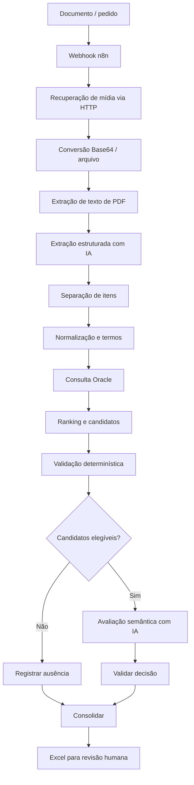

# Arquitetura

> **Status: Protótipo em desenvolvimento.** A arquitetura descrita reflete a exportação disponível e pode mudar.

O fluxo no n8n recebe um evento por webhook, recupera a mídia por uma API HTTP, converte o conteúdo para arquivo e extrai texto de PDF. Em seguida, OpenAI interpreta o pedido; nós JavaScript separam itens, normalizam atributos e preparam a busca. O Oracle retorna candidatos. Regras determinísticas filtram incompatibilidades antes de uma possível avaliação semântica com IA. A decisão é validada e consolidada em um Excel para conferência.

A intenção futura é aceitar imagem, PDF, foto ou texto e preparar um orçamento no Winthor. Essa integração de ponta a ponta não deve ser presumida como existente: o workflow presente termina na planilha de conferência e não mostra gravação do orçamento no Winthor.
